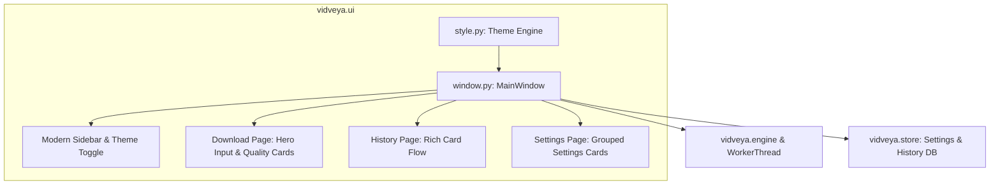

# UI/UX Redesign Implementation Plan

> **For agentic workers:** REQUIRED SUB-SKILL: Use superpowers:subagent-driven-development to implement this plan task-by-task. Steps use checkbox (- [ ]) syntax for tracking.

**Goal:** Transform VidVeya's frontend into a modern Windows 11 Fluent card-based UI with Light/Dark dual themes, progressive card flow, immersive 5-stage progress indicator, and streamlined settings/history.

**Architecture:**
- Centralize styling in a dynamic theme engine in src/vidveya/ui/style.py with design tokens for Light and Dark modes.
- Modernize MainWindow in src/vidveya/ui/window.py to use card-based layouts, rich format item badges, 5-stage progress meters, persistent mini-progress sidebar indicators, and categorized settings cards.
- Support runtime theme switching and ensure all existing pytest UI tests pass.

**Architecture Diagram:**

**Tech Stack:** PySide6 (Qt for Python), QSS, Python 3.12, SQLite.
**Spec:** docs/superpowers/specs/2026-09-15-ui-ux-redesign-design.md

## Global Constraints
- Python 3.12, PySide6 6.8+
- Preserve all public methods and attributes used in tests/test_ui.py
- All unit tests and ruff lint checks must pass

---

### Task 1: Theme Engine and Dynamic Stylesheet (style.py)

**Files:**
- Modify: src/vidveya/ui/style.py
- Test: tests/test_ui.py

- [ ] **Step 1: Write tests for theme generator**
- [ ] **Step 2: Implement get_theme_stylesheet(theme) with Light/Dark palette and modern QSS**
- [ ] **Step 3: Run pytest to verify**

---

### Task 2: Modernize Sidebar and Main Window Shell (window.py)

**Files:**
- Modify: src/vidveya/ui/window.py
- Test: tests/test_ui.py

- [ ] **Step 1: Add theme switching action and dynamic stylesheet reloading**
- [ ] **Step 2: Update sidebar with modern styling, theme switch button, and mini-task indicator**
- [ ] **Step 3: Run pytest to verify**

---

### Task 3: Redesign Main Download Page & Quality Cards (window.py)

**Files:**
- Modify: src/vidveya/ui/window.py
- Test: tests/test_ui.py

- [ ] **Step 1: Redesign Link Input area to hero card**
- [ ] **Step 2: Upgrade Video Info preview card with modern layout & badges**
- [ ] **Step 3: Upgrade format selector to sleek quality cards/chips**
- [ ] **Step 4: Upgrade 5-stage progress meter and completion shortcuts**
- [ ] **Step 5: Run pytest to verify**

---

### Task 4: Redesign History and Settings Pages (window.py)

**Files:**
- Modify: src/vidveya/ui/window.py
- Test: tests/test_ui.py

- [ ] **Step 1: Refactor History page to card-based list with row actions**
- [ ] **Step 2: Refactor Settings page to grouped category cards with theme dropdown**
- [ ] **Step 3: Run pytest and ruff check**
