# VidVeya UI/UX 与产品体验全面重构实施计划

> **For agentic workers:** REQUIRED SUB-SKILL: Use superpowers:subagent-driven-development to implement this plan task-by-task. Steps use checkbox (`- [ ]`) syntax for tracking.

**Goal:** 依据已批准的架构设计规格，对 VidVeya 的新建下载页、下载记录页和设置页进行端到端的 UI、UX 和交互体验重构，实现极简现代、零冗余、低心智负担的流线型桌面工作台体验。

**Architecture:** 保持现有底层引擎与存储接口不变，通过扩展现代化 Fluent 样式系统，在新建下载页用“流线型输入胶囊 + 视频 Hero 卡片 + 画质芯片组 + 原位动态进度”替代旧版技术表格堆叠；在下载记录页增加“实时搜索过滤框 + 富媒体表格 + 行内悬停快捷动作条”并移除底部冗余按钮；在设置页引入“即改即存（Auto-Save）”机制并整合为三大结构化紧凑卡片。

**Architecture Diagram:**

```mermaid
graph TD
    subgraph UI_Layer ["UI / UX 展现层 (MainWindow)"]
        Nav["侧边栏导航"]
        PageNew["新建下载页 (New Download)"]
        PageHist["下载记录页 (History)"]
        PageSet["设置页 (Settings)"]
    end

    subgraph New_Download_Components ["新建下载核心组件"]
        HeroInput["Hero 输入胶囊 (URL + 清空 + 粘贴解析)"]
        HeroCard["视频 Hero 卡片 (缩略图 + 标题 + 权限)"]
        QualityChips["画质选择芯片组 (4K / 1080P / 720P / 音频)"]
        ProgressArea["一体化动态进度与完成态 (原位平滑过渡)"]
    end

    subgraph History_Components ["下载记录核心组件"]
        HistToolbar["顶部工具栏 (统计徽章 + 实时搜索过滤框 + 清空)"]
        HistTable["现代多媒体表格 (药丸微标 + 状态指示小圆点)"]
        HoverActions["行内悬停快捷动作条 (▶ 播放 / 📂 打开文件夹)"]
    end

    subgraph Settings_Components ["设置核心组件"]
        AutoSaveEngine["即改即存引擎 (Auto-Save on Change)"]
        CardPref["基础偏好卡片 (主题 / 语言 / 退出行为)"]
        CardNet["下载与网络卡片 (目录 + 快捷打开 + 代理)"]
        CardAuth["账号与诊断卡片 (Cookie 导入 + 简明健康徽章)"]
    end

    PageNew --> HeroInput
    PageNew --> HeroCard
    PageNew --> QualityChips
    PageNew --> ProgressArea

    PageHist --> HistToolbar
    PageHist --> HistTable
    PageHist --> HoverActions

    PageSet --> AutoSaveEngine
    PageSet --> CardPref
    PageSet --> CardNet
    PageSet --> CardAuth
```



**Tech Stack:** Python 3.12, PySide6 (Qt for Python 6.11.2), Fluent QSS, SQLite3, pytest-qt, ruff

**Spec:** `docs/superpowers/specs/2026-09-16-ui-ux-modernization-design.md`

## Global Constraints

- 绝不破坏既有引擎命令交互（`analyze`, `download`, `diagnostics`）与数据模型契约。
- 保证全部既有自动化测试用例（含已增加的 78 个用例）在测试重构后 100% 保持通过。
- 绝不引入第三方重型 UI 库依赖，完全复用 PySide6 与 Fluent QSS 原生能力。
- 全量新组件严格遵循中英双语国际化（`i18n.py`）同步规范。
- 严格遵循代码规范，`ruff check src tests` 保持 0 错误。

---

### Task 1: 样式系统与新视觉控件 Tokens 扩展

**Files:**
- Modify: `src/vidveya/ui/style.py`
- Test: `tests/test_ui.py`

**Interfaces:**
- Produces: 
  - `QualityChip` 芯片控件样式（支持 normal, hover, selected 属性状态）
  - `HeroInput` 胶囊输入栏复合样式
  - `SearchInput` 搜索框现代样式
  - `InlineAction` 悬停快捷按钮样式

- [ ] **Step 1: 编写视觉样式的结构验证测试**
  在 `tests/test_ui.py` 中添加 `test_stylesheet_contains_modern_tokens`：
  ```python
  def test_stylesheet_contains_modern_tokens():
      from vidveya.ui.style import get_theme_stylesheet
      for theme in ("light", "dark"):
          qss = get_theme_stylesheet(theme)
          assert "QualityCard" in qss
          assert "HeroInput" in qss
          assert "SearchInput" in qss
          assert "InlineAction" in qss
  ```

- [ ] **Step 2: 运行测试验证失败**
  `pytest tests/test_ui.py -k test_stylesheet_contains_modern_tokens -v`
  预期：FAIL（缺少对应 QSS 规则）

- [ ] **Step 3: 在 `src/vidveya/ui/style.py` 中实现新样式规则**
  添加画质卡片芯片、Hero 输入胶囊、实时搜索框与行内动作图标的精致 QSS：
  ```css
  QWidget#QualityCard {
      background: {tokens['bg_surface']};
      border: 1px solid {tokens['border']};
      border-radius: 10px;
      padding: 10px 14px;
  }
  QWidget#QualityCard:hover {
      border-color: {tokens['border_strong']};
      background: {tokens['bg_hover']};
  }
  QWidget#QualityCard[selected="true"] {
      border: 2px solid {tokens['accent']};
      background: {tokens['accent_tint']};
  }
  QFrame#HeroInput {
      background: {tokens['bg_surface']};
      border: 1px solid {tokens['border_strong']};
      border-radius: 12px;
  }
  QFrame#HeroInput:focus-within {
      border: 2px solid {tokens['accent']};
  }
  QLineEdit#SearchInput {
      background: {tokens['bg_surface']};
      border: 1px solid {tokens['border']};
      border-radius: 8px;
      padding: 6px 12px;
      font-size: 13px;
  }
  QPushButton#InlineAction {
      border: none;
      background: transparent;
      border-radius: 4px;
      padding: 4px;
  }
  QPushButton#InlineAction:hover {
      background: {tokens['bg_hover']};
  }
  ```

- [ ] **Step 4: 运行测试验证通过**
  `pytest tests/test_ui.py -k test_stylesheet_contains_modern_tokens -v`
  预期：PASS

- [ ] **Step 5: 提交更改**
  `git add src/vidveya/ui/style.py tests/test_ui.py`
  `git commit -m "style: add modern UI tokens for quality chips, hero inputs, and actions"`

---

### Task 2: 国际化词条扩充与多语言映射

**Files:**
- Modify: `src/vidveya/i18n.py`
- Test: `tests/test_ui.py`

**Interfaces:**
- Produces: 新增搜索过滤占位符、推荐画质标识、自动保存反馈、快捷复制提示等中英文键值。

- [ ] **Step 1: 编写国际化新增词条验证测试**
  在 `tests/test_ui.py` 中添加 `test_new_modern_i18n_keys`：
  ```python
  def test_new_modern_i18n_keys():
      from vidveya.i18n import t, set_language
      for lang in ("zh", "en"):
          set_language(lang)
          for key in ("hist_search_placeholder", "dl_recommended", "set_auto_saved", "dl_quality_title", "dl_audio_only"):
              assert t(key) != key
  ```

- [ ] **Step 2: 运行测试验证失败**
  `pytest tests/test_ui.py -k test_new_modern_i18n_keys -v`
  预期：FAIL

- [ ] **Step 3: 在 `src/vidveya/i18n.py` 中补充词条**
  在 `TRANSLATIONS["zh"]` 和 `TRANSLATIONS["en"]` 中增加：
  - `hist_search_placeholder`: "🔍  搜索视频标题或格式…" / "🔍  Search title or format…"
  - `dl_recommended`: "推荐" / "Recommended"
  - `set_auto_saved`: "✓ 设置已自动保存" / "✓ Settings auto-saved"
  - `dl_quality_title`: "选择下载画质" / "Select Download Quality"
  - `dl_audio_only`: "纯音频" / "Audio Only"
  - `dl_btn_download_quality`: "下载此视频 ({res})" / "Download Video ({res})"
  - `dl_clear`: "清空" / "Clear"

- [ ] **Step 4: 运行测试验证通过**
  `pytest tests/test_ui.py -k test_new_modern_i18n_keys -v`
  预期：PASS

- [ ] **Step 5: 提交更改**
  `git add src/vidveya/i18n.py tests/test_ui.py`
  `git commit -m "i18n: add translations for quality selector, search and auto-save"`

---

### Task 3: 新建下载页重构（Hero 输入胶囊、视频卡片、画质选择芯片、原位进度）

**Files:**
- Modify: `src/vidveya/ui/window.py`
- Test: `tests/test_ui.py`

**Interfaces:**
- Consumes: `QualityCard` 样式、`formats.py` 中的解析选项。
- Produces: 
  - `QualityChipWidget`（可视清晰度选择卡片）
  - `MainWindow.url_input` 保持现有引用，但外观包裹于 `HeroInput` 容器
  - `MainWindow.fill_formats` 将技术参数表无缝转化为横向流式画质芯片组
  - 智能一键粘贴解析 `MainWindow.paste_and_analyze`
  - 智能一键清空 `MainWindow.clear_url`
  - `MainWindow.download_selected` 绑定当前高亮卡片参数并触发下载

- [ ] **Step 1: 编写新建下载页视觉与交互测试**
  测试画质芯片组生成、选中状态切换、粘贴自动触发解析、保持 `window.download_button` 兼容性：
  ```python
  def test_quality_chips_selection_and_workflow(make_window, media_info):
      window = make_window()
      window.ready = True
      # 传入解析完成的元数据
      info = {"video_id": media_info["id"], "url": "https://youtu.be/YE7VzlLtp-4", "title": "Test Video",
              "channel": "Channel", "duration": 120, "thumbnail": None,
              "options": [option.to_dict() for option in build_options(media_info)]}
      window.show_video(info)
      assert hasattr(window, "quality_container")
      assert len(window.quality_chips) > 0
      # 验证默认选中最佳画质芯片
      assert window.selected_quality_option is not None
      assert window.download_button.isEnabled()
  ```

- [ ] **Step 2: 运行测试验证失败**
  `pytest tests/test_ui.py -k test_quality_chips_selection_and_workflow -v`
  预期：FAIL

- [ ] **Step 3: 重构 `MainWindow._build_download_page` 及关联方法**
  - 构建 `HeroInput` 输入胶囊；
  - 实现 `QualityChipWidget`：包含大号清晰度标签、MP4 格式、大小预估、推荐角标；
  - 弃用旧的 `QTableWidget` 模式表格，使用可流式排列的 `quality_container`；
  - 保持属性兼容（如 `self.url_input`, `self.download_button`, `self.cancel_button`）；
  - 下载进行时，原位平滑显示大百分比动态圆角进度条与实时速度/剩余时间；
  - 下载完成时，原位展现绿色成功徽标与高优先级双主动作（播放视频 / 打开文件夹）。

- [ ] **Step 4: 运行测试验证通过**
  `pytest tests/test_ui.py -k test_quality_chips_selection_and_workflow -v`
  预期：PASS

- [ ] **Step 5: 提交更改**
  `git add src/vidveya/ui/window.py tests/test_ui.py`
  `git commit -m "feat(ui): overhaul download page with hero capsule, quality chips, and smooth progress"`

---

### Task 4: 下载记录页重构（实时搜索过滤、富媒体表格、行内悬停动作、清理底部冗余）

**Files:**
- Modify: `src/vidveya/ui/window.py`
- Test: `tests/test_ui.py`

**Interfaces:**
- Produces: 
  - `MainWindow.search_input` 实时搜索框
  - `MainWindow.filter_history(query)` 实时模糊过滤
  - 表格行高与药丸微标呈现
  - 行内悬停快捷动作（播放/定位）

- [ ] **Step 1: 编写搜索过滤与行内动作测试**
  ```python
  def test_history_search_filtering(make_window):
      window = make_window()
      window.store.save_job({"id": "1", "created": timestamp(), "title": "PySide Tutorial", "state": "completed", "option": {"resolution": 1080, "container": "mp4"}})
      window.store.save_job({"id": "2", "created": timestamp(), "title": "Rust Guide", "state": "completed", "option": {"resolution": 720, "container": "mp4"}})
      window.refresh_history()
      assert len(window.display_jobs) == 2
      
      # 输入搜索过滤
      window.search_input.setText("PySide")
      assert len(window.display_jobs) == 1
      assert window.display_jobs[0]["title"] == "PySide Tutorial"
      
      # 清空搜索
      window.search_input.setText("")
      assert len(window.display_jobs) == 2
  ```

- [ ] **Step 2: 运行测试验证失败**
  `pytest tests/test_ui.py -k test_history_search_filtering -v`
  预期：FAIL

- [ ] **Step 3: 重构 `MainWindow._build_history_page` 与 `refresh_history`**
  - 在顶部工具栏加入 `SearchInput` 实时输入过滤框；
  - 移除底部散乱的 4 个按钮栏，界面大幅减负；
  - 增强表格绘制：行高设为 `44px`，清晰度字段绘制为 `药丸微标`，状态字段带颜色指示圆点；
  - 表格中集成悬停快捷操作图标，右键菜单保留完整操作能力；
  - 保留兼容性属性 `self.delete_history_button`, `self.reveal_button`, `self.retry_button` 设为内部引用或隐式兼容。

- [ ] **Step 4: 运行测试验证通过**
  `pytest tests/test_ui.py -k test_history_search_filtering -v`
  预期：PASS

- [ ] **Step 5: 提交更改**
  `git add src/vidveya/ui/window.py tests/test_ui.py`
  `git commit -m "feat(ui): modernize history page with real-time search, rich badges, and hover actions"`

---

### Task 5: 设置页重构（即改即存 Auto-Save、三卡片聚合、组件健康徽标）

**Files:**
- Modify: `src/vidveya/ui/window.py`
- Test: `tests/test_ui.py`

**Interfaces:**
- Produces:
  - `MainWindow.auto_save(key, value)` 即改即存触发器
  - 移除手动“保存设置”大按钮
  - 整合为三大紧凑卡片（基础偏好、存储与网络、凭据与组件）

- [ ] **Step 1: 编写设置即改即存（Auto-Save）测试**
  ```python
  def test_settings_auto_save(make_window):
      window = make_window()
      # 改变关闭行为
      window.close_action_input.setCurrentIndex(1)
      assert window.store.get_setting("close_action") == "exit"
      # 改变关闭提示复选框
      window.close_prompt_input.setChecked(False)
      assert window.store.get_setting("confirm_close") is False
      # 改变代理输入
      window.proxy_input.setText("http://127.0.0.1:8888")
      window.proxy_input.editingFinished.emit()
      assert window.store.get_setting("proxy") == "http://127.0.0.1:8888"
  ```

- [ ] **Step 2: 运行测试验证失败**
  `pytest tests/test_ui.py -k test_settings_auto_save -v`
  预期：FAIL

- [ ] **Step 3: 重构 `MainWindow._build_settings_page` 并实现自动保存机制**
  - 为所有输入项绑定即时持久化信号：
    - `theme_input.currentIndexChanged` -> 自动更新 store 并应用主题；
    - `language_input.currentIndexChanged` -> 自动更新 store 并切换语言；
    - `close_action_input.currentIndexChanged` -> 自动更新 store；
    - `close_prompt_input.toggled` -> 自动更新 store；
    - `directory_input.textChanged` 及 `choose_directory` -> 自动更新 store；
    - `proxy_input.editingFinished` -> 自动校验并更新 store；
  - 彻底移除显式的“保存设置”孤立大按钮；
  - 将设置页面紧凑布局为三个精致卡片；
  - 优化组件检查区域为简明状态指示，健康时简洁收起，异常时展示排查详情。

- [ ] **Step 4: 运行测试验证通过**
  `pytest tests/test_ui.py -k test_settings_auto_save -v`
  预期：PASS

- [ ] **Step 5: 提交更改**
  `git add src/vidveya/ui/window.py tests/test_ui.py`
  `git commit -m "feat(ui): implement auto-save settings and restructure settings cards"`

---

### Task 6: 全量自动化测试回归与代码规范审查

**Files:**
- Modify: `tests/test_ui.py`
- Test: All test suites in `tests/`

- [ ] **Step 1: 运行 ruff 静态检查**
  `.\.venv\Scripts\ruff.exe check src tests`
  预期：0 error, 0 warning

- [ ] **Step 2: 运行 UI 专项测试套件**
  `.\.venv\Scripts\pytest tests/test_ui.py -v`
  预期：全部通过

- [ ] **Step 3: 运行全量 78+ 个测试用例**
  `.\.venv\Scripts\pytest -q`
  预期：100% 全部通过

- [ ] **Step 4: 提交测试与代码调优**
  `git add tests/`
  `git commit -m "test: ensure 100% test coverage for modernized UI and UX flows"`

---

### Task 7: 页面视觉验证与最终 Walkthrough 报告

**Files:**
- Modify: `walkthrough.md`
- Output: 抓取优化后的三大主界面渲染截图并记录于 `walkthrough.md`

- [ ] **Step 1: 运行自动化截图抓取脚本**
  生成新建下载页、下载记录页、设置页在浅色和深色模式下的真实渲染图片。
- [ ] **Step 2: 更新 `walkthrough.md`**
  系统记录重构前后的交互对比、视觉成果和全量测试验证数据。
- [ ] **Step 3: 最终确认工作区状态**
  `git status`
