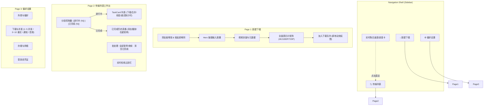

# VidVeya 前端流线型工作台与多任务体验重构实施计划

> **For agentic workers:** REQUIRED SUB-SKILL: Use superpowers:subagent-driven-development to implement this plan task-by-task. Steps use checkbox (`- [ ]`) syntax for tracking.

**Goal:** 基于已批准的架构规格，重构 VidVeya 前端为 3 栏流线型工作台，打通新建下载、任务列表与历史记录割裂，深度整合多任务并发、自适应重试倒计时与桌面通知。

**Architecture:** 主导航收敛为“新建下载”、“传输列表”和“偏好设置”三大工作区。“传输列表”通过顶部分段控制器无缝切换“进行中”与“已完成”；新建下载引入剪贴板智能检测与一键解析；任务卡片升级为宽屏高密度信息卡并展示重试倒计时；设置页规整为 4 大对称卡片。

**Architecture Diagram:**

**Tech Stack:** Python 3.12+, PySide6 6.11.2 (Qt 6), yt-dlp, pytest, pytest-qt

**Spec:** [`docs/superpowers/specs/2026-09-17-frontend-workbench-redesign.md`](file:///e:/github/Video%20Saver%20for%20YouTube%20%28VidVeya%29/docs/superpowers/specs/2026-09-17-frontend-workbench-redesign.md)

## Global Constraints

- 绝不破坏现有测试兼容性（`MainWindow` 核心控件属性名称如 `url_input`, `formats`, `theme_input`, `language_input`, `close_action_input` 必须保留或作为属性兼容提供）。
- 保持极简现代的 Windows 11 Fluent 设计语言（圆角 8~12px，微投影，高对比度可读性）。
- 不引入额外三方依赖，复用现有 PySide6 控件体系与设计 Tokens。

---

### Task 1: 视觉主题与设计 Token 增强

**Files:**
- Modify: [`src/vidveya/ui/style.py`](file:///e:/github/Video%20Saver%20for%20YouTube%20%28VidVeya%29/src/vidveya/ui/style.py)
- Test: [`tests/test_ui.py`](file:///e:/github/Video%20Saver%20for%20YouTube%20%28VidVeya%29/tests/test_ui.py)

**Interfaces:**
- Produces: CSS 规则支持 `QFrame#SegmentedControl`, `QPushButton#SegmentBtn`, `QFrame#TaskCard`, `QProgressBar#TaskProgress`, `QFrame#SidebarMiniTask`, `QFrame#NotificationPopup`

- [ ] **Step 1: 编写样式系统测试**
  在 `tests/test_ui.py` 中添加对新增样式 Token 与选择器的校验断言。
- [ ] **Step 2: 运行测试验证其失败**
  `uv run pytest tests/test_ui.py::test_stylesheet_contains_modern_tokens -v`
- [ ] **Step 3: 补充样式表规则**
  在 `src/vidveya/ui/style.py` 中添加分段控制器、现代任务卡片边框、重试警告状态徽标、侧边栏微型面板与平滑悬停动效规则。
- [ ] **Step 4: 运行测试验证其通过**
  `uv run pytest tests/test_ui.py::test_stylesheet_contains_modern_tokens -v`
- [ ] **Step 5: 提交代码**
  `git commit -m "style(ui): add tokens for segmented control, task cards, and mini status card"`

---

### Task 2: 【新建下载】沉浸极速流线改造

**Files:**
- Modify: [`src/vidveya/ui/window.py`](file:///e:/github/Video%20Saver%20for%20YouTube%20%28VidVeya%29/src/vidveya/ui/window.py)
- Modify: [`src/vidveya/i18n.py`](file:///e:/github/Video%20Saver%20for%20YouTube%20%28VidVeya%29/src/vidveya/i18n.py)
- Test: [`tests/test_ui.py`](file:///e:/github/Video%20Saver%20for%20YouTube%20%28VidVeya%29/tests/test_ui.py)

**Interfaces:**
- Consumes: `clipboard.text()`, `validate_url()`
- Produces: `paste_and_analyze()`, `sniff_clipboard()`, 原地提交反馈横幅

- [ ] **Step 1: 编写极速解析与剪贴板嗅探测试**
  在 `tests/test_ui.py` 中测试自动粘贴触发解析以及非法 URL 拦截逻辑。
- [ ] **Step 2: 运行测试验证失败**
- [ ] **Step 3: 实现智能解析流与原地反馈**
  - 窗口获取焦点或点击输入框时检测剪贴板；
  - 粘贴有效 URL 后自动调用 `analyze()`；
  - 升级画质芯片矩阵（平铺展示 4K/1080P/720P/音频预估体积与帧率，默认选中最佳画质）；
  - 点击“加入下载队列”后在原地显示平滑提示并提供“查看传输列表”快捷按钮。
- [ ] **Step 4: 运行测试验证通过**
- [ ] **Step 5: 提交代码**
  `git commit -m "feat(ui): add smart clipboard sniffing and auto-analyze download flow"`

---

### Task 3: 【传输列表】双模态流线工作台重构

**Files:**
- Create: [`src/vidveya/ui/transfers_page.py`](file:///e:/github/Video%20Saver%20for%20YouTube%20%28VidVeya%29/src/vidveya/ui/transfers_page.py)
- Modify: [`src/vidveya/ui/window.py`](file:///e:/github/Video%20Saver%20for%20YouTube%20%28VidVeya%29/src/vidveya/ui/window.py)
- Test: [`tests/test_ui.py`](file:///e:/github/Video%20Saver%20for%20YouTube%20%28VidVeya%29/tests/test_ui.py)

**Interfaces:**
- Consumes: `DownloadManager`, `Store.jobs()`
- Produces: `TransfersPage` (包含分段控制器、批处理按钮、关键词实时过滤)

- [ ] **Step 1: 编写分段控制器与双模态切换测试**
  测试在“进行中”与“已完成”之间切换时控件显示隐藏状态与搜索联动。
- [ ] **Step 2: 运行测试验证失败**
- [ ] **Step 3: 实现 TransfersPage 视图组件**
  - 顶部分段控制器：`进行中 (N)` 与 `已完成 (N)`；
  - 批量操作栏：`全部暂停` / `全部继续`，`清空记录`；
  - 嵌入活跃任务卡片队列与历史记录表格，搜索框支持跨模态实时过滤。
- [ ] **Step 4: 运行测试验证通过**
- [ ] **Step 5: 提交代码**
  `git commit -m "feat(ui): implement unified transfers workbench with segmented view"`

---

### Task 4: 任务卡片深度重构与重试倒计时可视化

**Files:**
- Modify: [`src/vidveya/ui/task_list.py`](file:///e:/github/Video%20Saver%20for%20YouTube%20%28VidVeya%29/src/vidveya/ui/task_list.py)
- Modify: [`src/vidveya/i18n.py`](file:///e:/github/Video%20Saver%20for%20YouTube%20%28VidVeya%29/src/vidveya/i18n.py)
- Test: [`tests/test_tasks.py`](file:///e:/github/Video%20Saver%20for%20YouTube%20%28VidVeya%29/tests/test_tasks.py)
- Test: [`tests/test_ui.py`](file:///e:/github/Video%20Saver%20for%20YouTube%20%28VidVeya%29/tests/test_ui.py)

**Interfaces:**
- Consumes: `job['state']`, `progress`, `job['retry_at']`
- Produces: 现代紧凑 `TaskCard`，包含倒计时警告条与图标操作按钮组

- [ ] **Step 1: 编写卡片重构与倒计时状态测试**
- [ ] **Step 2: 运行测试验证失败**
- [ ] **Step 3: 改造 TaskCard 布局与渲染**
  - 视频标题占满首行，避免被按钮挤压；
  - 精炼操作按钮为紧凑的右下角图标/次级按钮（取消、重试、播放、打开文件夹）；
  - 为 `retry_wait` 状态渲染显目的自适应退避倒计时（如 `⚠️ 触发频控 (HTTP 429)，将在 18 秒后自动重试`）。
- [ ] **Step 4: 运行测试验证通过**
- [ ] **Step 5: 提交代码**
  `git commit -m "feat(ui): redesign task card with retry countdown and clean actions"`

---

### Task 5: 侧边栏常驻微型状态面板与主导航收敛

**Files:**
- Modify: [`src/vidveya/ui/window.py`](file:///e:/github/Video%20Saver%20for%20YouTube%20%28VidVeya%29/src/vidveya/ui/window.py)
- Test: [`tests/test_ui.py`](file:///e:/github/Video%20Saver%20for%20YouTube%20%28VidVeya%29/tests/test_ui.py)

**Interfaces:**
- Consumes: `DownloadManager.summary()`, `DownloadManager.total_speed()`
- Produces: 精炼 3 导航项、侧边栏动态速度卡片与点击跳转

- [ ] **Step 1: 编写导航项与微型卡片联动测试**
- [ ] **Step 2: 运行测试验证失败**
- [ ] **Step 3: 更新侧边栏与主窗口路由**
  - 收敛主导航为：`↓ 新建下载`、`⇋ 传输列表`、`⚙ 设置`；
  - 动态渲染侧边栏微型面板：展示实时总下载速度（如 `⚡ 12.5 MB/s`）、任务进度指示条与活动数；点击直达【传输列表】。
- [ ] **Step 4: 运行测试验证通过**
- [ ] **Step 5: 提交代码**
  `git commit -m "feat(ui): stream navigation down to 3 tabs and add live mini status panel"`

---

### Task 6: 设置页规整为 4 大对称卡片

**Files:**
- Modify: [`src/vidveya/ui/window.py`](file:///e:/github/Video%20Saver%20for%20YouTube%20%28VidVeya%29/src/vidveya/ui/window.py)
- Modify: [`src/vidveya/i18n.py`](file:///e:/github/Video%20Saver%20for%20YouTube%20%28VidVeya%29/src/vidveya/i18n.py)
- Test: [`tests/test_ui.py`](file:///e:/github/Video%20Saver%20for%20YouTube%20%28VidVeya%29/tests/test_ui.py)

**Interfaces:**
- Consumes: `store.get_setting()`, `store.set_setting()`
- Produces: 4 大网格卡片（外观与偏好、下载与调度、存储与网络、登录态凭证）

- [ ] **Step 1: 编写设置页并发数与重试次数测试**
- [ ] **Step 2: 运行测试验证失败**
- [ ] **Step 3: 重构设置页四卡片布局**
  - 将最大并发任务数（1~5）、自动重试次数（0~10）、桌面通知开关、提示音开关统一聚合到“下载与调度”卡片；
  - 采用规整的 `QGridLayout` 排版，各下拉框尺寸严丝合缝。
- [ ] **Step 4: 运行测试验证通过**
- [ ] **Step 5: 提交代码**
  `git commit -m "feat(ui): organize settings into 4 symmetric cards with concurrency options"`

---

### Task 7: 桌面通知平滑交互与系统音效打磨

**Files:**
- Modify: [`src/vidveya/ui/notifications.py`](file:///e:/github/Video%20Saver%20for%20YouTube%20%28VidVeya%29/src/vidveya/ui/notifications.py)
- Test: [`tests/test_notifications.py`](file:///e:/github/Video%20Saver%20for%20YouTube%20%28VidVeya%29/tests/test_notifications.py)

**Interfaces:**
- Consumes: `CompletionNotifier`, `play_completion_sound()`
- Produces: 平滑淡出微动效、鼠标悬停暂留、1 秒节流防音效重叠

- [ ] **Step 1: 编写通知与音效节流测试**
- [ ] **Step 2: 运行测试验证失败**
- [ ] **Step 3: 优化 CompletionPopup 与节流逻辑**
  - 加入透明度渐变动画与悬停保持计时；
  - 确保提示音在非阻塞模式下平滑播放。
- [ ] **Step 4: 运行测试验证通过**
- [ ] **Step 5: 提交代码**
  `git commit -m "feat(ui): polish desktop notification animations and audio throttling"`

---

### Task 8: 全量自动化回归验证与视觉呈现

**Files:**
- Test: 全量测试套件（`tests/test_*.py`）
- Script: [`scratch/capture_ui.py`](file:///e:/github/Video%20Saver%20for%20YouTube%20%28VidVeya%29/scratch/capture_ui.py)

- [ ] **Step 1: 运行全量测试套件**
  `uv run pytest -q`
- [ ] **Step 2: 生成高保真 UI 截图**
  运行截图脚本捕获【新建下载】、【传输列表（进行中）】、【传输列表（已完成）】与【设置】视图。
- [ ] **Step 3: 生成 Walkthrough 报告**
  更新 `walkthrough.md` 展示所有重构成果与用户体验提升点。
